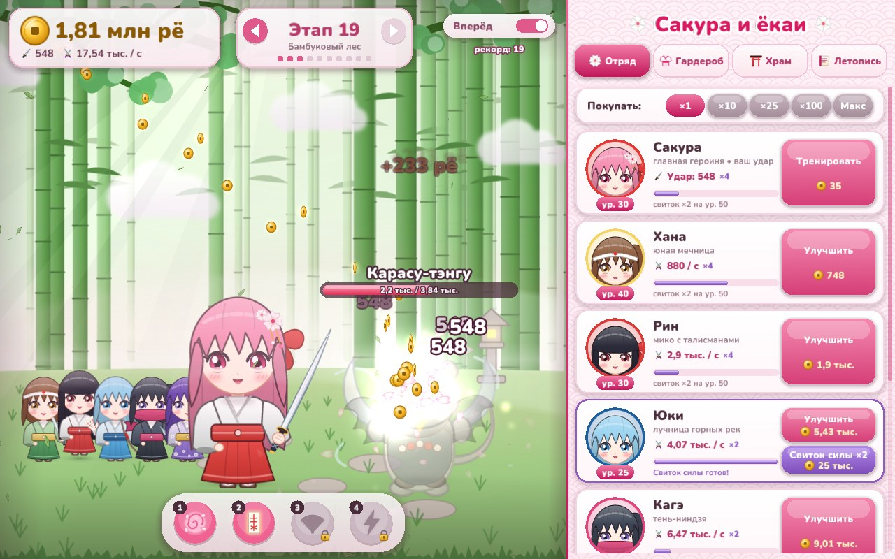
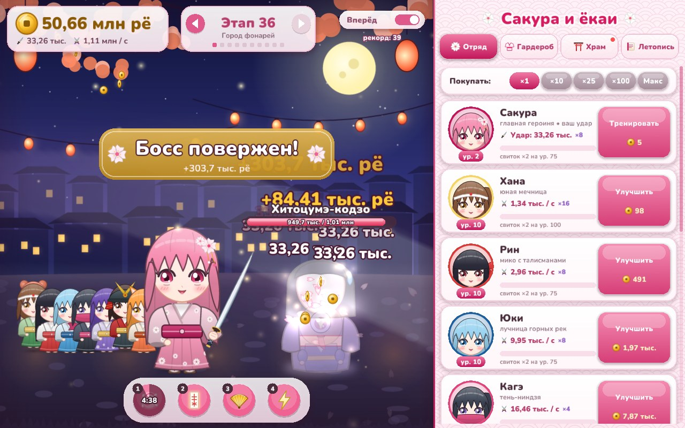

# 🌸 Сакура и ёкаи

Аниме-кликер для компьютера на **Rust**. Сакура и её отряд героинь сражаются с ёкаями
японского фольклора: от каппы в сакуровой роще до восьмиглавого Ямата-но Ороти в небесном дворце.




## Как запустить

**Windows:** скачайте [`dist/SakuraYokai.exe`](dist/SakuraYokai.exe) и запустите. Ничего устанавливать не нужно.

**Собрать самому** (Windows, Linux, macOS) — нужен [Rust](https://rustup.rs):
```bash
cargo run --release
```
Готовые сборки для всех трёх систем также собирает GitHub Actions (вкладка **Actions** → артефакты).

## Как играть

- **Кликайте по ёкаю** — Сакура бьёт катаной. Иногда выпадает **крит** (×5).
- **Отряд героинь** сражается сам: мечница Хана, мико Рин, лучница Юки, ниндзя Кагэ,
  Аямэ с нагинатой, самурай Томоэ, лисья волшебница Мия и ещё 6 героинь. Нанятые героини
  стоят на поле боя рядом с Сакурой.
- Уровни покупаются по ×1 / ×10 / ×25 / ×100 / Макс. На уровнях 10, 25, 50, 75, 100…
  открываются **свитки силы** — ×2 к урону героини.
- **Этапы:** на каждом 10 ёкаев, каждый 5-й этап — **босс** с таймером. Не успели —
  отряд отступает, прокачайтесь и попробуйте снова.
- **7 локаций:** Сакуровая роща, Бамбуковый лес, Горный храм, Город фонарей,
  Снежный перевал, Огненный вулкан, Небесный дворец — со своими ёкаями, боссами и погодой.
- **Гардероб:** 9 нарядов Сакуры выпадают с боссов — юката, мико, доспехи самурая,
  ниндзя, зимнее кимоно, лисья жрица, фурисодэ, облачение богини. Каждый даёт бонус.
- **Навыки** (клавиши 1–4): Буря лепестков, Благословение, Золотой веер, Небесный удар.
- **Храм** (с этапа 30): перерождение за души сакуры (+10% урона каждая) и вечные талисманы.
- Игра **сохраняется сама**, а отряд добывает золото, даже когда игра закрыта (до 8 часов).

| Клавиша | Действие |
|---|---|
| Клик мышью | удар Сакуры |
| 1 – 4 | навыки |
| ← / → | предыдущий / следующий этап |
| A | авто-продвижение вперёд |

Сохранение: `%APPDATA%\SakuraYokai\save.txt` (Windows),
`~/Library/Application Support/SakuraYokai/save.txt` (macOS), `~/.local/share/sakura-yokai/save.txt` (Linux).

## Как устроена графика

Картинок-файлов в проекте нет: героини, ёкаи, пейзажи и иконки **собираются в коде как SVG**
(кривые Безье, градиенты, размытие) и растеризуются библиотекой [resvg](https://github.com/linebender/resvg)
под текущий размер окна — поэтому всё чёткое на любом мониторе. Отрисовка и окно —
[macroquad](https://macroquad.rs) (OpenGL), шрифт — [Nunito](https://fonts.google.com/specimen/Nunito) (SIL OFL).

Режим для разработки: `cargo run --release -- --preview папка` сохраняет листы со всеми спрайтами в PNG.

| Файл | Что внутри |
|---|---|
| `src/game.rs` | логика: бой, золото, этапы, боссы, навыки, перерождение (+ тесты) |
| `src/data.rs` | героини, наряды, навыки, талисманы, локации, ёкаи |
| `src/art/chibi.rs` | героини в стиле чиби: причёски, кимоно, аниме-глаза, оружие |
| `src/art/yokai.rs` | 28 ёкаев |
| `src/art/scenery.rs` | пейзажи локаций |
| `src/art/icons.rs` | иконки и частицы |
| `src/gfx.rs` | шейдеры, текст, панели со скруглением и тенями |
| `src/scene.rs` | поле боя, анимации, эффекты, интерфейс поверх сцены |
| `src/ui.rs` | правая панель: Отряд, Гардероб, Храм, Летопись |
| `src/save.rs` | сохранение |
